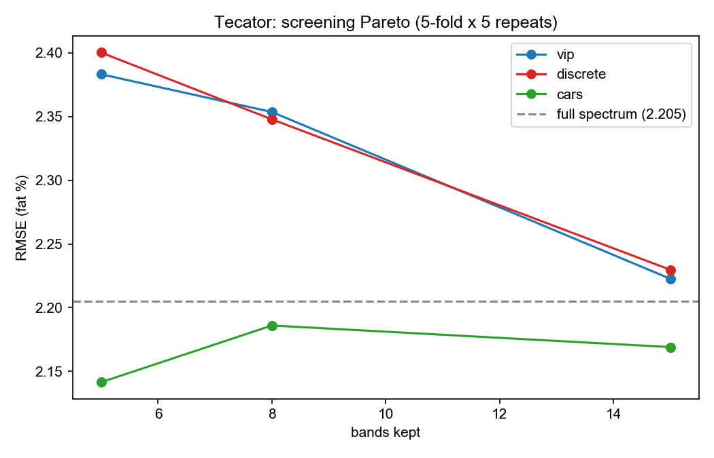

# spectra-screen

> Find the few wavelengths that matter. Reproducible **wavelength screening** and
> **spectral machine learning** benchmarks for hyperspectral / NIR data.


## Why this exists

Hyperspectral and NIR systems collect hundreds of contiguous bands, but in most
industrial problems — food grading, recycling, pharma QC, precision forestry —
the discriminative signal lives in a **handful of wavelengths**. Fewer bands mean
cheaper filter-based cameras instead of full HSI push-broom scanners, faster
scanning, and smaller, more interpretable, easier-to-validate models.

**spectra-screen** benchmarks wavelength-screening methods against full-spectrum
baselines on public datasets. Every table and figure in this README is generated
by code in this repo (`make benchmarks`) — nothing hand-typed, no cherry-picked
runs: 5-fold × 5 repeats, fixed seed, mean ± std.

## Headline result (Tecator)

**CARS-selected 5 bands out of 100 beat the full-spectrum baseline** —
RMSE 2.141 ± 0.335 vs 2.205 ± 0.355 (fat %), pooled R² 0.9771 vs 0.9757.
A 20× channel reduction with no loss of accuracy.



## Install & quickstart

```bash
pip install -e '.[dev]'

# full-spectrum PLS baseline on Tecator (downloads data on first use, caches under ./data)
screener tecator --method none --model pls

# greedy discrete screening, 8 well-separated bands
screener tecator --method discrete --k 8 --model pls

# VIP top-8 / CARS top-8
screener tecator --method vip --k 8
screener tecator --method cars --k 8

# regenerate every number and figure in this README
make benchmarks
```

## Methods

| Method | Type | Origin |
|---|---|---|
| Discrete screening | filter, band-level, enforced min wavelength separation | seed method from Lin et al., WHISPERS 2019 (simplified univariate version) |
| CARS | iterative competitive adaptive reweighted sampling | Li et al., Chemom. Intell. Lab. Syst. 2009 (seeded deterministic variant) |
| VIP-PLS | embedded, variable-level | classic chemometrics (Wold et al.) |

Preprocessing: SNV + Savitzky-Golay (window 11, order 2) for NIR spectra;
per-fold standardization (train-fold fit, no leakage) for hyperspectral
classification. Models: PLS / Ridge / SVR for regression; SVM-RBF /
Random-Forest for classification. Protocol: 5-fold × 5 repeats, fixed seed,
mean ± std — no best-run cherry-picking. Screening methods run on the full
labelled set once (identical protocol for all methods, so method rankings are
comparable; absolute numbers are upper bounds).

## Tecator benchmark

n=240 meat samples, 100 NIR absorbance channels @ 850–1048 nm (2 nm steps),
target: fat content (%). Full results: [`results/tecator.json`](results/tecator.json).

| Method | Bands | Best model | RMSE (fat %) mean ± std | Pooled R² |
|---|---|---|---|---|
| full spectrum | 100 | pls | 2.205 ± 0.355 | 0.9757 |
| CARS | **5** | pls | **2.141 ± 0.335** | **0.9771** |
| CARS | 8 | pls | 2.186 ± 0.319 | 0.9762 |
| CARS | 15 | pls | 2.169 ± 0.317 | 0.9766 |
| VIP | 15 | pls | 2.223 ± 0.304 | 0.9755 |
| VIP | 8 | pls | 2.354 ± 0.400 | 0.9723 |
| VIP | 5 | pls | 2.383 ± 0.361 | 0.9717 |
| discrete | 15 | pls | 2.230 ± 0.382 | 0.9751 |
| discrete | 8 | pls | 2.348 ± 0.427 | 0.9723 |
| discrete | 5 | pls | 2.400 ± 0.424 | 0.9711 |

Observations:

- **CARS dominates at every budget** — it is the only method that beats the
  full-spectrum baseline, and it does so with 5 bands.
- Univariate discrete screening and VIP plateau higher; they rank bands
  individually and miss interaction/complementary-band effects that CARS's
  PLS-weighted competition captures.
- On Tecator, PLS is uniformly the strongest regressor — consistent with
  chemometrics folklore on small-n, highly collinear spectra.

## Indian Pines benchmark (classification)

AVIRIS scene, 200 bands (water-absorption channels removed), 16 crop/forest
classes; ≤200 pixels per class (n=2587), SVM-RBF with per-fold standardization.
Full results: [`results/indian_pines.json`](results/indian_pines.json).

| Method | Bands | SVM-RBF accuracy | Random Forest accuracy |
|---|---|---|---|
| full spectrum | 200 | **0.8555 ± 0.0103** | 0.8307 ± 0.0112 |
| discrete | 15 | 0.8337 ± 0.0123 | 0.8085 ± 0.0127 |
| discrete | 8 | 0.6721 ± 0.0111 | 0.6832 ± 0.0148 |
| discrete | 5 | 0.5820 ± 0.0145 | 0.5677 ± 0.0205 |
| ANOVA top-k | 15 | 0.5585 ± 0.0137 | 0.5665 ± 0.0166 |
| ANOVA top-k | 8 | 0.4873 ± 0.0150 | 0.5030 ± 0.0194 |
| ANOVA top-k | 5 | 0.4721 ± 0.0146 | 0.4741 ± 0.0166 |

Observations:

- **Spaced beats dense at the same budget**: with 15 bands, discrete screening
  (enforced min separation) reaches 0.834 accuracy vs 0.559 for naive
  top-15-by-F — the separation constraint spreads bands across absorption
  features instead of clustering on the few strongest ones.
- 15 well-spaced bands recover ~97% of full-spectrum SVM accuracy with 7.5%
  of the channels.

## TabPFN comparison (Tecator)

TabPFN v3 (prior-fitted tabular foundation model, Hollmann et al., Nature 2025)
as the regressor behind the same selection methods (CPU-only run; regenerate
with `make tabpfn`):

| Method | Bands | TabPFN RMSE (fat %) | Pooled R² |
|---|---|---|---|
| full spectrum | 100 | 0.501 ± 0.081 | 0.9987 |
| discrete | 15 | 0.572 ± 0.095 | 0.9984 |
| CARS | 5 | 0.826 ± 0.145 | 0.9966 |
| discrete | 8 | 0.781 ± 0.127 | 0.9970 |
| VIP | 15 | 0.719 ± 0.105 | 0.9974 |

Observations:

- TabPFN is dramatically stronger than PLS everywhere on Tecator
  (0.50 vs 2.21 full-spectrum RMSE) — modern tabular foundation models change
  what the modeling ceiling looks like even on n=240 spectra.
- The headline shifts with the model: with TabPFN, **15 discrete bands
  (0.572) degrade RMSE by only 14% vs full spectrum (0.501)**, while 5-band
  CARS costs 65% RMSE. Channel reduction still costs little — but the Pareto
  frontier must be re-derived per model class, not assumed.
- Selected bands stay consistent with the PLS-era selections, indicating the
  wavelength information is model-robust.

Compute note: the TabPFN numbers above were produced with a CPU-only HPC job
(4 cores / 8 GB, 10.5 min for 10 configurations). A portable Slurm template
ships in [`hpc/sbatch_tabpfn.sh`](hpc/sbatch_tabpfn.sh) — set your partition and
Python interpreter, then `sbatch` it. First-use model weights live in
`~/.cache/tabpfn/` and can be copied between machines to keep inference offline.

## Provenance & related work

- Y. Lin et al., *Discrete wavelengths screening method for the near-infrared
  spectroscopic analysis of serum glucose*, WHISPERS 2019 — the seed of this toolkit.
- Y. Lin et al., *Multidimensional light detection with symmetry-engineered
  heterojunctions*, arXiv:2609.02161 (2026) — the hardware-side counterpart:
  fewer optical channels through detector design, fewer spectral bands through software.

## Scope & roadmap

Currently two datasets (Tecator regression, Indian Pines classification) plus a
TabPFN foundation-model comparison on Tecator. Planned next:

- [x] Indian Pines hyperspectral classification (SVM-RBF, RF)
- [x] TabPFN comparison (v3, CPU-only — see above, `make tabpfn`)
- [ ] PaviaU (urban classification) as a third scene
- [ ] Stability selection (LASSO) and mutual-information screening
- [ ] Band-stability analysis across CV folds (how reproducible is a selected band?)

## Work with me

I'm a doctoral researcher in photonics at Aalto University (Finland), working on
ultrafast laser processing, spectroscopy, and spectral machine learning.

- **Spectral ML pipelines** — dataset triage, wavelength selection, deployable models
- **Ultrafast laser process development** — parameter-window scouting for new materials

📬 yucai.lin@aalto.fi

## License

MIT — see [LICENSE](LICENSE).
