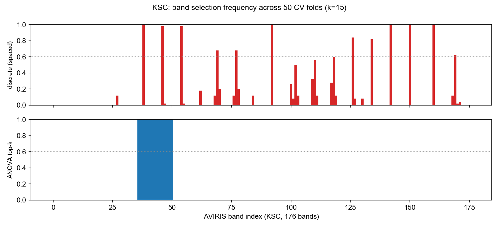
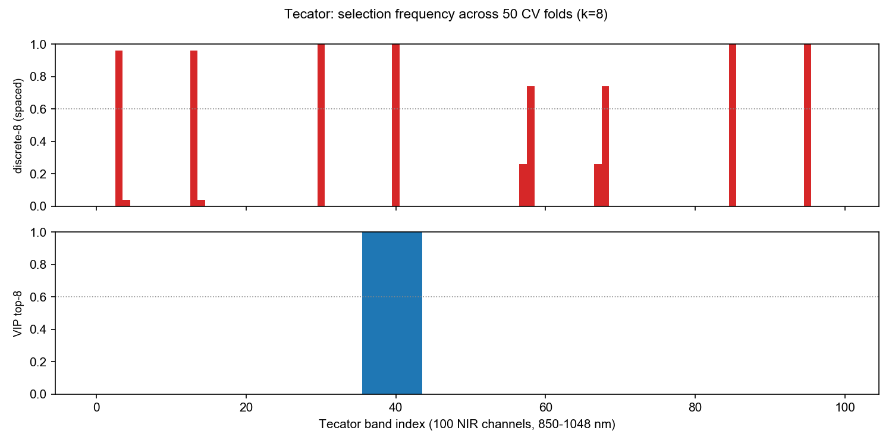
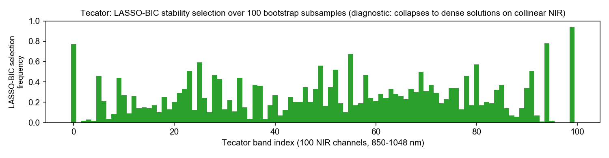

# Band-Selection Stability Report — Sample

**What you are looking at:** the deliverable format of a fixed-fee engagement. This sample was produced on two public datasets (AVIRIS Kennedy Space Center forestry scene; Tecator NIR meat spectra) with the open-source [`spectra-screen`](https://github.com/linyc007/spectra-screen) toolkit. Every number below regenerates from the repo with fixed seeds.

---

## Executive summary

1. **Selection quality and selection stability are different axes.** On KSC, the naive "top-15 by F-score" is perfectly repeatable across 50 CV folds (Jaccard = 1.000) yet delivers only 0.643 accuracy — while the spaced discrete selection (Jaccard = 0.600, swap-stable at its core) delivers **0.808** with the same 15-band budget. *A selection procedure that never changes is not automatically a good one.*
2. **Stable cores exist and are usable.** The discrete method keeps 4/8 bands identical across every Tecator fold (selection frequency 1.00) and 5/15 on KSC — enough to define a hardened "instrument band set" for a filter-based camera, with fringe positions treated as tunable.
3. **LASSO-BIC is a diagnostic, not a selector, on small collinear spectra.** On Tecator (n=240) it retains ~80 of 100 bands under BIC — the failure mode your team would hit with naive use of sklearn defaults. We surface it so you don't ship it.

---

## 1. KSC forestry scene (AVIRIS, 512×614 px, 176 bands, 13 vegetation classes)

Balanced sampling (≤200 px/class, n=2466), SVM-RBF, 5-fold × 10 repeats; selection re-run on every training fold (50 folds).

| Selection method (k=15) | Fold-to-fold Jaccard | Accuracy of consensus set |
|---|---|---|
| Discrete (spaced, min-sep 8) | 0.600 | **0.808 ± 0.012** |
| ANOVA top-k (dense) | 1.000 | 0.643 ± 0.014 |

- **Core bands** (chosen in ≥98% of folds): AVIRIS bands 38, 46, 92, 142, 150, 160 — these are the backbone; the remaining positions rotate within the same spectral neighborhoods.
- The dense top-k selector always picks the same 15 bands because they all sit in the few strongest absorption features — individually strong, collectively redundant.

## 2. Tecator NIR (n=240, 100 channels, 850–1048 nm, fat %)

| Selection method (k=8) | Fold-to-fold Jaccard |
|---|---|
| Discrete (spaced, min-sep 10) | 0.814 |
| VIP top-k | 1.000 |

- **Core bands** (frequency 1.00): channels 30, 40, 85, 95 (≈ 910, 930, 1020, 1040 nm); channel 3 at 0.96.
- Reference points from the same protocol: CARS-5 RMSE 2.141 ± 0.335 vs full-spectrum PLS 2.205 ± 0.355 — the deployed band set should be benchmarked, not just ranked.
- **LASSO-BIC diagnostic** (100 bootstrap subsamples): top band 99 (freq 0.94), but total support collapses to ~80/100 bands — BIC does not enforce sparsity on collinear spectra at this n. 

## 3. What this looks like for *your* data

Fixed-fee pilot, 5 working days, your data stays on your own infrastructure throughout. You receive:

- a one-page report in exactly this format (stability heatmaps, Jaccard matrix, consensus band list with selection frequencies);
- the hardened band set + the tunable fringe positions, ready for a filter-camera spec;
- accuracy/RMSE of the consensus set vs your current full-spectrum baseline, same CV protocol on both;
- reproducible code drop (seeds fixed), so your team can re-run after each data revision.

**Input needed from you:** one labelled dataset (any format), the task definition, and one call.

---

*Methods: stability selection after Meinshausen & Bühlmann (2010); fold-repeatability and consensus-set definitions in `src/spectra_screen/stability.py`; protocol details and full results in the repo (`results/stability_*.json`). Sample produced by Yucai Lin, Aalto University — yucai.lin@aalto.fi.*
